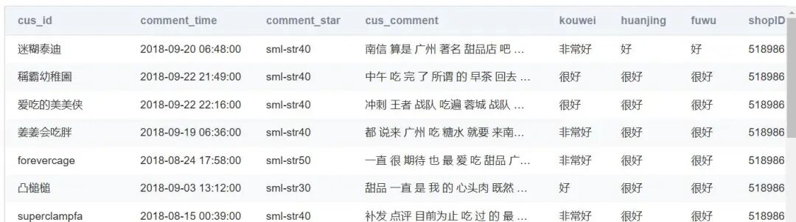

# [Dataset] 30,000 reviews from Dianping.com

Background description: Dazhongping.com was established in Shanghai in April 2003. It is a leading local life information and trading platform in China, as well as the world's first independent third-party consumer review website.

## **Background Description**

Dazhongping.com was established in Shanghai in April 2003. It is a leading local life information and trading platform in China, as well as the world's first independent third-party consumer review website. Dazhongping not only provides users with merchant information, consumer reviews, and consumption discounts but also offers O2O (Online To Offline) transaction services such as group buying, restaurant reservations, takeout, and electronic membership cards.

On October 8, 2015, Dianping.com and Meituan.com jointly issued a statement announcing the establishment of a new company, Meituan Dianping.

In January 2016, the "Dazhongping" app under Meituan-DiDi Pinduoduo was honored as one of the "Top Ten Most Popular Apps in 2015" by Tencent's Application Treasure Trove. Additionally, "Dazhongping" is the only food and health-related app to have received this award.

## **Data Description**

This data is related to a review dataset from Dianping, totaling over 30,000 records. The main columns include:

|

List name

 ||

Notes

 |

|

cus_id

 ||

Customer name

 |
|

comment_time

 ||

Comment time

 |
|

comment_star

 ||

Comment star rating

 |
|

cus_comment

 ||

Comment content

 |
|

kouwei

 ||

Flavor rating

 |
|

huanjing

 ||

Environmental score

 |
|

fuwu

 ||

Service rating

 |
|

shopID

 ||

Store ID

 |
|

stars

 ||

Likes

 |
|

year

 ||

Year

 |
|

month

 ||

Month

 |
|

weekday

 ||

What day of the week?

 |
|

hour

 ||

Time

 |
|

comment_len

 ||

Comment length

 |

## **
**

## **Problem Description**

For natural language processing, sentiment analysis, and so on...

Data screenshot:

## Payment

Here is a pay link on Stripe ( https://buy.stripe.com/3cs8yP7sY87d0vu9AB ). Please contact me lonlonago@foxmail.com after funding $89, and I will send you a complete data files , thank you!

